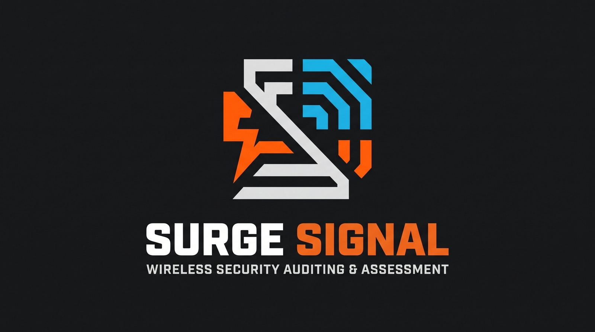
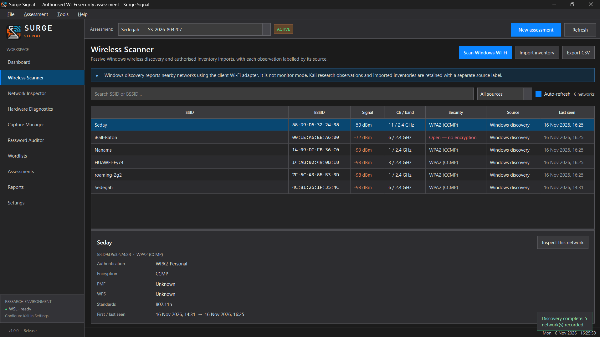
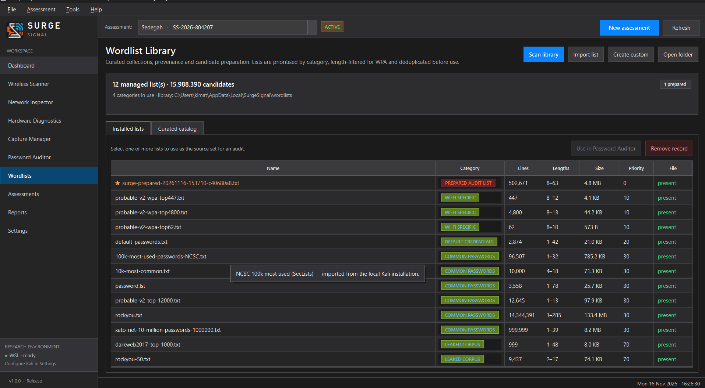

# SURGE Signal

**Check your own Wi-Fi, understand its weak points, and keep a clear record.**

SURGE Signal is a desktop app for checking Wi-Fi safety. It finds nearby
networks, explains how each one is protected, helps you record the proof needed
to test your own Wi-Fi password, and produces a report you can keep.

It is meant for home users, small businesses and authorised testers working on
networks they own or have permission to test.

> **Only test networks you own or have written permission to test.** SURGE Signal
> listens; it does not knock other people off Wi-Fi or break into networks.

---

## What it can do

### Find nearby Wi-Fi

Open **Wireless Scanner** and press **Scan Wi-Fi**. You will see:

- the network name;
- its address;
- how strong the signal is;
- which channel it uses;
- whether it is open or protected;
- when it was last seen.

The app only listens. It does not connect to the networks it finds.

### Explain what is safe and what is not

Open **Network Inspector** and press **Run inspection**. Every nearby network is
shown, including networks with no obvious problem. Each network gets a simple
result:

- **Open** — anyone nearby can listen.
- **Old protection** — the network uses an outdated method.
- **Modern protection** — the network uses a stronger method.
- **Needs review** — something is unusual or unclear.

Each result explains what it means, why it matters and what to do about it in
plain language.

### Record the proof needed to test your password

Open **Capture Manager**, then choose **Live capture**.

The app will:

1. ask for your testing password;
2. find a suitable USB Wi-Fi stick;
3. put the stick into a listening-only mode;
4. record the connection proof from your own network;
5. save the recording in a folder on your Desktop called
   **Surge Signal Captures**;
6. bring the recording into the app automatically.

You can also bring in a recording made earlier with **Import capture**.

**What you need for recording:** a separate USB Wi-Fi stick that can listen in
this way, plus the Linux testing environment. The Wi-Fi card built into most
laptops cannot do this, and the app will tell you if it cannot find a suitable
stick. A Linux test system or a Linux USB stick is the reliable option.

You do **not** need to already have a recording before opening the password
checker. If there is no recording, the app opens the recording window for you.

### Test your own Wi-Fi password

Open **Password Auditor**, then the **password checker**.

1. Enter your testing password.
2. Press the sign-in button. The app checks what is already installed and adds
   only what is missing. It does not reinstall everything
   each time.
3. Pick the recording.
4. Pick a password list, or tick **Run all installed password lists**.
5. Tick the confirmation box.
6. Press the main password-test button.

If the password is found, it is shown once on screen. You can copy it or clear
it. The app saves only a hidden version, never the real password.

A password list is a list of common passwords. The app already has 12 real
lists installed on this computer. **Run all** combines them, removes duplicates
and skips passwords that cannot be Wi-Fi passwords.

If the password is not found, it only means it was not in the lists. It does not
mean the Wi-Fi is safe.

### Keep your work together

Each piece of work lives in a workspace. A workspace keeps:

- the networks you saw;
- the results you reviewed;
- your recordings;
- your password-test results;
- your notes and reports.

All of this stays on your computer.

### Make a report

Open **Reports** and create a report in one of three formats:

- a web page for reading on screen;
- a PDF for printing or sharing;
- a data file for another tool.

The report includes the networks found, the results, the evidence and the
recommended next steps. Your SURGE Signal banner appears on the cover.

---

## Screenshots

**Wireless Scanner** — see nearby networks and their protection.

**Password Lists** — the 12 lists already installed.

---

## Getting started on Windows

1. Install **SURGE Signal** using the setup file.
2. Open it from the Start menu.
3. Use **Wireless Scanner** to find nearby networks.
4. Use **Network Inspector** to understand them.
5. Use **Capture Manager** when you are ready to test your own Wi-Fi password.

The app does not need an account and does not send your data anywhere.

### If you want to run it from the project folder

Double-click **Surge Signal.bat**. It sets up what it needs the first time and
then opens the app.

---

## Getting started on Linux

The project includes files for building a Linux application package. A Linux
build should be made and tested on the Linux computer where it will be used.

After installing the package, open **SURGE Signal** from the applications menu.

---

## Before you record: the USB Wi-Fi stick

Recording needs a separate USB Wi-Fi stick that can listen to Wi-Fi traffic.
Most built-in laptop Wi-Fi cards cannot do this.

The app will show a message if no suitable stick is found. If you are using
the Linux environment inside Windows, the built-in card cannot be shared with
it. Use a USB Wi-Fi stick, a Linux test system, or a Linux USB stick.

The built-in card can still be used for normal scanning on Windows.

---

## Your data

Everything is stored on your computer:

- the app's own folder;
- your recordings in **Desktop > Surge Signal Captures**;
- your reports wherever you choose to save them.

Nothing is uploaded.

Your testing password is used only to allow the app to run the testing
tools. It is never saved. A found Wi-Fi password is shown once and is not saved
in the app's records.

---

## Safety

- Test only Wi-Fi you own or have written permission to test.
- Do not use the app on a network you do not control.
- The app listens only. It does not disconnect other people's devices.
- Keep your recordings and reports private.
- If you are testing for a business, follow that business's rules and keep the
  written permission with the report.

---

## If something goes wrong

- **No networks appear:** make sure Wi-Fi is on and allowed to show nearby
  networks.
- **No USB Wi-Fi stick is found:** connect a suitable stick, or use a Linux
  test system or Linux USB stick.
- **The password is not found:** try a larger password list or add your own.
- **The app will not open:** restart the computer and try again.

---

**SURGE Signal — see your Wi-Fi clearly, test it safely, and keep the evidence.**
